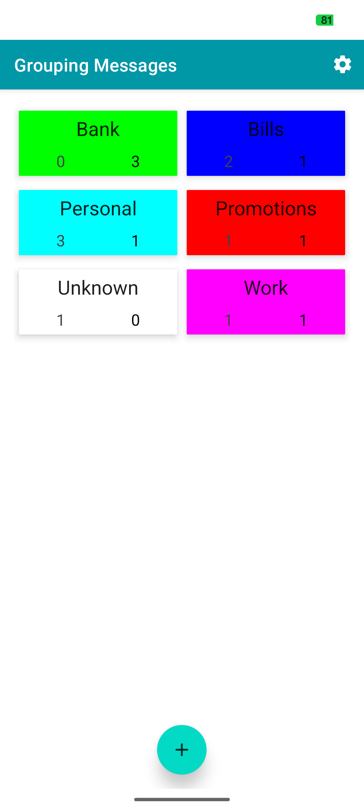
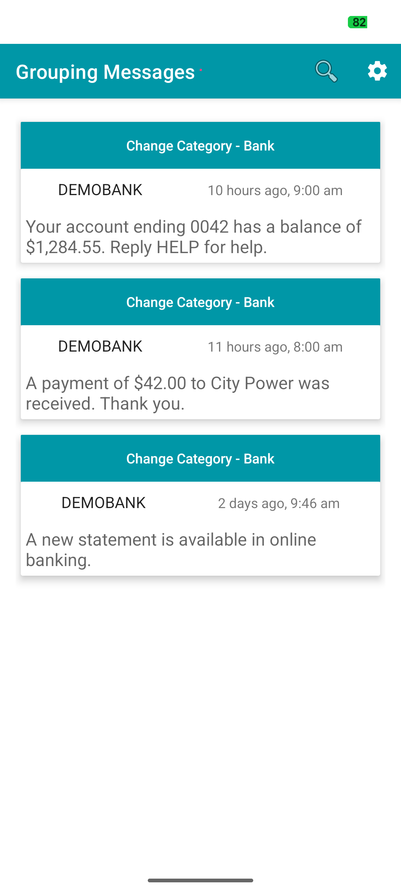
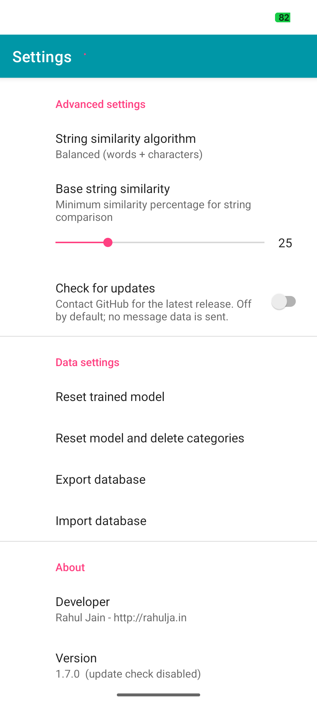

# Grouping Messages

[](https://github.com/xRahul/GroupingMessages/actions/workflows/ci.yml)
[](https://github.com/xRahul/GroupingMessages/actions/workflows/instrumented.yml)
[](https://github.com/xRahul/GroupingMessages/blob/master/LICENSE)
[](https://github.com/xRahul/GroupingMessages/issues)
[](https://github.com/xRahul/GroupingMessages/releases/latest)

An Android app that automatically categorizes your SMS into categories of your choice.

- **Minimum supported Android:** 7.0 Nougat (API 24)
- **Target/compile SDK:** Android 16 (API 36)
- **Build JDK:** 21

Every trained model is user specific: the app learns from the messages you move into
categories, so each user's categorization fits their own inbox. It needs some training at
the beginning, and it keeps learning every time you correct a message's category.

All SMS processing happens **on-device** — there are no external APIs involved in reading,
training, or categorizing messages (see [Privacy](#privacy)).

## Features

- Automatic categorization of incoming SMS using a hybrid on-device classifier
  (word TF-IDF cosine + character-trigram similarity, see
  [docs/ARCHITECTURE.md](docs/ARCHITECTURE.md))
- User-defined categories with colors; Unknown fallback for unclassified messages
- Training: move a message to the right category and similar future messages follow;
  re-training can propagate a correction to already-stored similar messages
- Per-category read/unread counts and mark-all-read
- Search within a category by message text, sender or contact name
- Configurable similarity mode (balanced / words only / characters only / legacy
  Levenshtein) and threshold in Settings
- Database backup and restore through the system file picker
- Opt-in update check against GitHub releases (the app's only network call)

## Screenshots







## Building

Requirements:

- JDK 21 (Temurin recommended)
- Android SDK with platform 36 (Gradle downloads the rest via the wrapper)

```bash
./gradlew assembleDebug        # debug APK
./gradlew lintDebug            # Android lint
./gradlew testDebugUnitTest    # JVM unit tests (Robolectric)
./gradlew connectedDebugAndroidTest  # instrumented tests (device/emulator required)
```

## Releasing

A release is built from an existing annotated tag `vX.Y.Z`. The tag is the only source
of truth:

- `versionName` = `X.Y.Z`
- `versionCode` = `X*10000 + Y*100 + Z`

```bash
git tag -a v1.7.0 -m "Grouping Messages 1.7.0"
git push origin v1.7.0
```

You can also run **Release -> Run workflow** and pick `patch`, `minor`, or `major`.
That bumps the version, updates the F-Droid recipe, commits, tags, and builds.

The release workflow runs unit tests and lint, builds the unsigned APK twice to confirm
the output is reproducible, signs it from the repository secrets, verifies the
signature and manifest, and uploads the release APK, a debug APK, and their SHA-256
files to the GitHub release. See [docs/RELEASING.md](docs/RELEASING.md).

## Store distribution

- **F-Droid:** metadata is in [`metadata/in.rahulja.groupingmessages.yml`](metadata/in.rahulja.groupingmessages.yml).
  F-Droid builds from the same tagged source.
- **IzzyOnDroid:** uses the signed APK attached to the GitHub release.
- **Google Play:** not targeted. Play restricts SMS permissions to default handlers or
  approved exceptions; this app is read-only and is not a default SMS handler.

Fastlane metadata lives in `fastlane/metadata/android/en-US/` and is validated by the
store workflow.

## Permissions rationale

| Permission | Why it is needed |
|---|---|
| `READ_SMS` | Read inbox messages to import them into the local database and categorize them. Nothing is ever sent anywhere. **Required.** |
| `READ_CONTACTS` | Show a contact's display name instead of a bare number. **Optional**; the app works without it. |
| `INTERNET` | One purpose only: the opt-in update check against `github.com/xRahul/GroupingMessages/releases/latest`. Off by default. |

## Privacy

- All SMS reading, cleaning, training, and categorization runs entirely on-device.
- Message content never leaves your phone. There is no analytics, no crash reporting,
  and no sync service.
- The **only** outbound network request is the update check. It is disabled by default;
  when enabled, it fetches the GitHub release redirect and sends no message data.
- OS-level auto-backup of app data is disabled (`allowBackup="false"`, extraction rules
  exclude cloud backup and device transfer).
- SMS content is never written to logcat.

## Backup & export

Settings exports a consistent copy of the SQLite database to a destination you choose in
the system file picker. The file contains every stored SMS, sender address, contact name
and category in plain text. Import validates the SQLite header, `PRAGMA integrity_check`,
the schema version and required tables on a scratch copy before replacing the live
database. See [docs/ARCHITECTURE.md](docs/ARCHITECTURE.md#backup-format-notes) for details.

## License

[Apache License 2.0](LICENSE)
