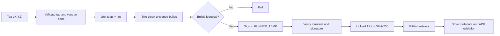

# Product Requirements Document (PRD)

## Overview

Grouping Messages is a local-only Android SMS organizer. The product requirement is not
an "enterprise pipeline"; it is a trustworthy offline tool that can be distributed by
F-Droid and IzzyOnDroid without hidden network behavior or data collection.

## Product requirements

1. Import SMS from the system inbox and categorize them on-device.
2. Keep all SMS text, sender addresses and contact names on the device.
3. Let the user correct a category and reuse that correction for similar messages.
4. Provide category management, read/unread state and search.
5. Provide an explicit, warned backup/restore path.
6. Require SMS permission; contacts are optional; the update check is opt-in.
7. Ship signed, reproducible release artifacts from a version tag.
8. Provide F-Droid and Fastlane metadata.

## Non-goals

- Sending, modifying or blocking SMS.
- Cloud sync, accounts, analytics, ads or crash reporting.
- Becoming a default SMS handler or targeting Google Play's restricted SMS policy.

## Release requirements

- Trigger: existing `vX.Y.Z` tag.
- `versionName = X.Y.Z`, `versionCode = X*10000 + Y*100 + Z`.
- Unit tests and lint must pass before signing.
- Two clean builds must be byte-identical.
- Signed APK and SHA-256 are attached to the GitHub release.
- F-Droid recipe and Fastlane metadata are validated by CI.

## Pipeline flow

